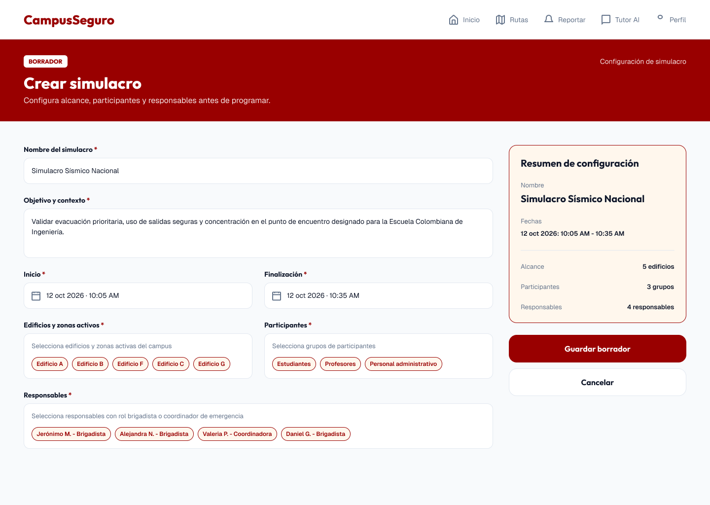
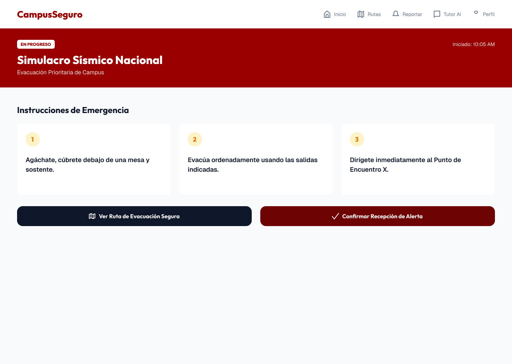
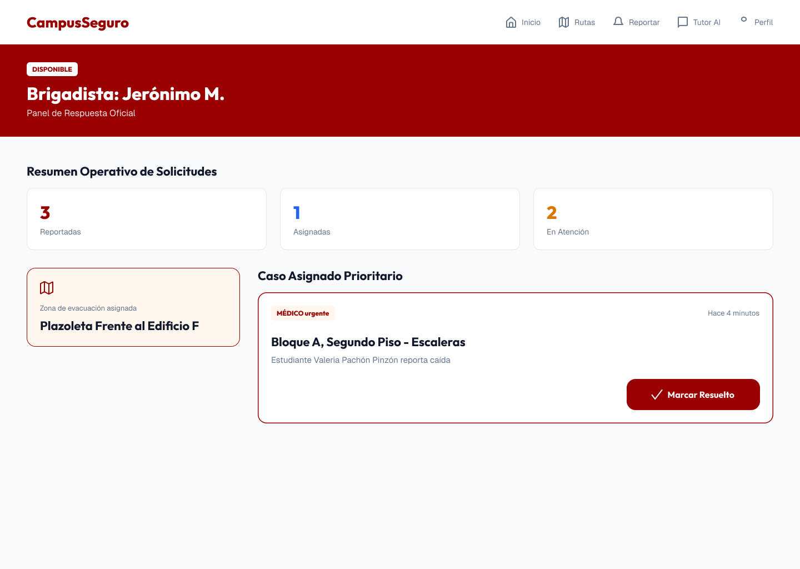

# CampusSeguro — Mockups del frontend

Referencia visual para el equipo.

---

## Guía visual compartida

| Elemento | Valor |
|---|---|
| Fuente de títulos, etiquetas y botones | Outfit (700 / 800) |
| Fuente de cuerpo | Geist (400 / 600) |
| Rojo principal | `#990000` |
| Rojo oscuro (acciones) | `#6E0303` |
| Azul noche | `#0F172A` |
| Texto secundario | `#64748B` |
| Borde | `#E2E8F0` |
| Fondo de página | `#F8FAFC` |
| Crema (píldoras, resumen, zona) | `#FFF7ED` |
| Amarillo pálido (números) | `#FEF3C7` |
| Naranja / Azul de acento | `#D97706` / `#2563EB` |
| Barra superior | 80 px de alto, padding horizontal 48 px |
| Encabezado rojo | 166 px de alto, padding 32 px / 48 px |
| Ancho de referencia | 1440 px |

---

## Pantallas

### 1. Crear simulacro

| Campo | Detalle |
|---|---|
| Ruta | `#/crear-simulacro` |
| Archivo | `src/modules/ms06-drills/pages/CreateSimulation.tsx` |
| Microservicio | MS06 — Simulacros |

**Notas:**
- _…_

---

### 2. Simulacro Sísmico Nacional (alerta activa)

| Campo | Detalle |
|---|---|
| Ruta | `#/simulacro` |
| Archivo | `src/modules/ms03-alerts/pages/ActiveSimulation.tsx` |
| Microservicio | MS03 — Alertas / MS06 — Simulacros |

**Notas:**
- _…_

---

### 3. Panel del brigadista

| Campo | Detalle |
|---|---|
| Ruta | `#/brigadista` |
| Archivo | `src/modules/ms05-brigades/pages/BrigadistaPanel.tsx` |
| Microservicio | MS05 — Brigadistas e Incidentes |

**Notas:**
- _…_

---

### 4. Administración

| Campo | Detalle |
|---|---|
| Ruta | `#/admin/edificios` |
| Archivo | `src/components/Layout.tsx` |
| Microservicio | MS02 · Campus y seguridad |

**Notas:**
- La opción «Administración» solo aparece para los roles ADMIN y COORDINADOR.

---

### 4.1 Consultar ruta · guía de evacuación

| Campo | Detalle |
|---|---|
| Ruta | `#/rutas` |
| Archivo | `src/modules/ms02-campus/pages/RouteQuery.tsx`, `components/GuiaEvacuacion.tsx` |
| Microservicio | MS02 · Campus y seguridad |

**Notas:**
- Cada tarjeta de ruta suma la sección «Guía de evacuación»: la indicación completa, la escalera a usar, la salida, la distancia y el tiempo de la ruta exterior, la zona segura y, desplegable, los pasos del recorrido exterior.
- Si la salida está en el mismo piso del espacio, la guía dice que no hace falta escalera.
- Si no hay escalera disponible o ninguna salida con ruta exterior, la sección muestra solo el aviso del backend.
- Al consultar un espacio la guía ya viene con la ruta. Al consultar todo el edificio el backend no la calcula, así que cada tarjeta ofrece el botón «Ver guía de evacuación», que la pide para ese espacio.

---

### 4.2 Zonas seguras con coordenadas

| Campo | Detalle |
|---|---|
| Ruta | `#/admin/zonas` |
| Archivo | `src/modules/ms02-campus/pages/ZonesAdmin.tsx` |
| Microservicio | MS02 · Campus y seguridad |

**Notas:**
- El formulario suma latitud y longitud (opcionales, van juntas), la zona abierta donde queda la zona segura y si es punto de encuentro (por defecto sí).
- La tabla muestra las coordenadas con el enlace «Ver en OpenStreetMap» y marca «Sin coordenadas» en las zonas que no las tienen.
- Encima de la tabla se avisa cuántas zonas activas no tienen coordenadas: no pueden ser destino de una ruta exterior.
- Las coordenadas y la zona abierta ya guardadas se pueden cambiar pero no borrar, porque el backend interpreta el campo vacío como «sin cambios».

---

### 4.3 Rutas de evacuación · ruta exterior

| Campo | Detalle |
|---|---|
| Ruta | `#/admin/rutas` |
| Archivo | `src/modules/ms02-campus/pages/RoutesAdmin.tsx`, `components/RutaExteriorAdmin.tsx` |
| Microservicio | MS02 · Campus y seguridad |

**Notas:**
- Debajo de la tabla de rutas hay la sección «Ruta exterior»: se elige edificio, salida y zona segura y se calcula el recorrido a pie con OpenStreetMap (distancia, tiempo y pasos). Calcular es solo del ADMIN; el COORDINADOR solo consulta lo guardado.
- Las zonas activas sin coordenadas aparecen deshabilitadas, porque no pueden ser destino.
- Al elegir una salida se listan sus rutas exteriores guardadas, sin volver a llamar al proveedor de navegación.
- Si el proveedor no responde o no hay recorrido peatonal, se muestra el mensaje del backend.

---

### 5. _Nueva pantalla_ (copiar esta sección)

| Campo | Detalle |
|---|---|
| Ruta | `#/…` |
| Archivo | `src/modules/msXX-…/pages/….tsx` |
| Microservicio | _MS0X_ |

**Notas:**
- _…_

---

## Pantallas pendientes de diseño

- [ ] Rutas
- [ ] Reportar
- [ ] Tutor AI
- [ ] Perfil

### 4.4 Escaleras de un edificio

| Campo | Detalle |
|---|---|
| Ruta | `#/admin/edificios/{id}` |
| Archivo | `src/modules/ms02-campus/components/EscalerasEdificio.tsx` |
| Microservicio | MS02 · Campus y seguridad |

**Notas:**
- El detalle del edificio permite consultar las escaleras que conectan sus pisos.
- ADMIN puede registrar escaleras seleccionando al menos dos pisos activos, e inactivarlas o reactivarlas.
- ADMIN y COORDINADOR pueden cambiar la disponibilidad de una escalera.
- Para bloquear una escalera o ponerla fuera de servicio se debe indicar el motivo.
- Las escaleras inactivas se pueden consultar cuando se activa la opción correspondiente.
